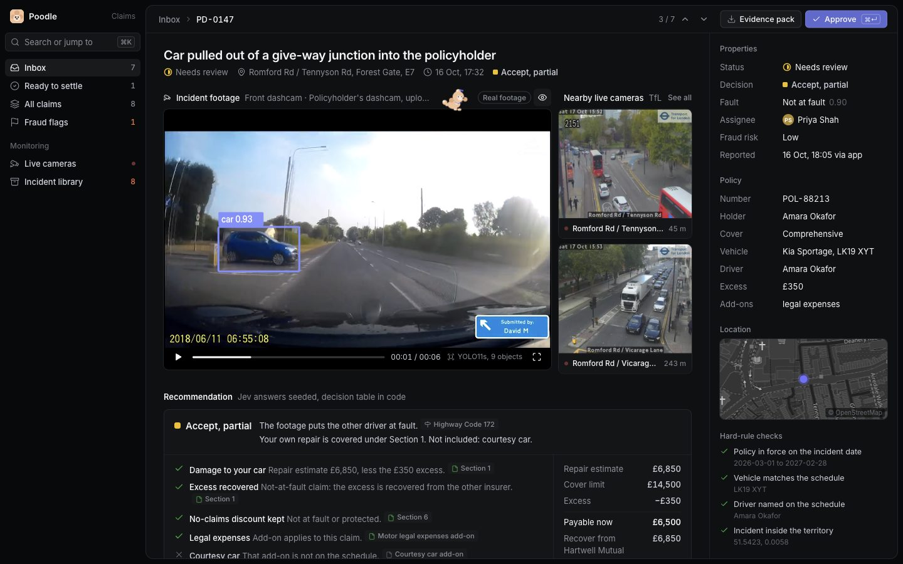
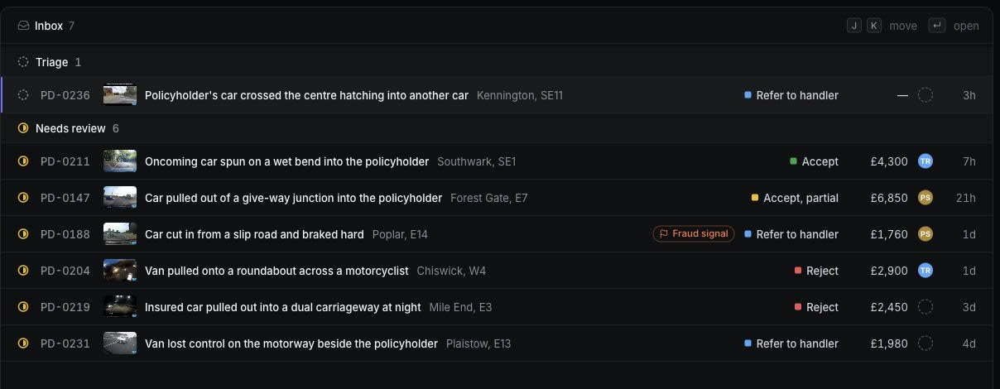
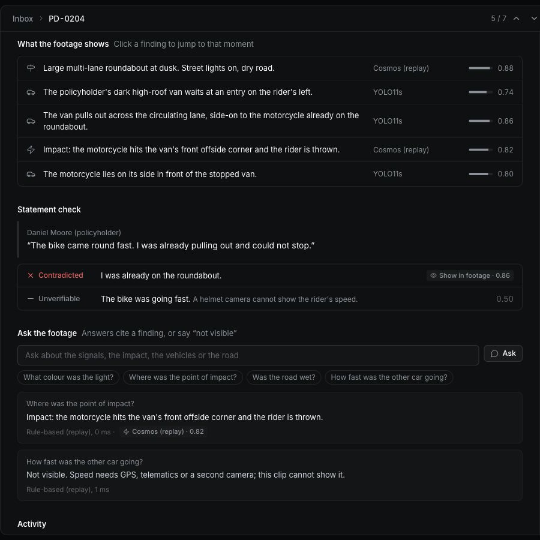
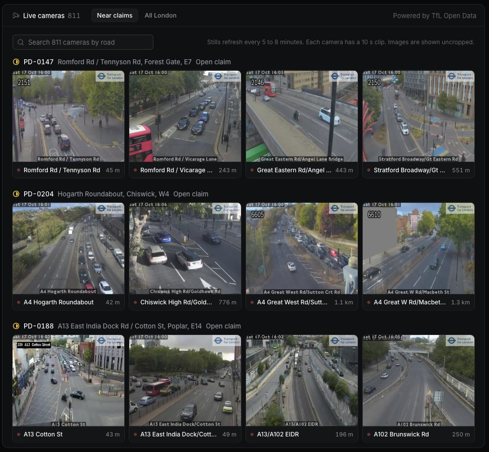
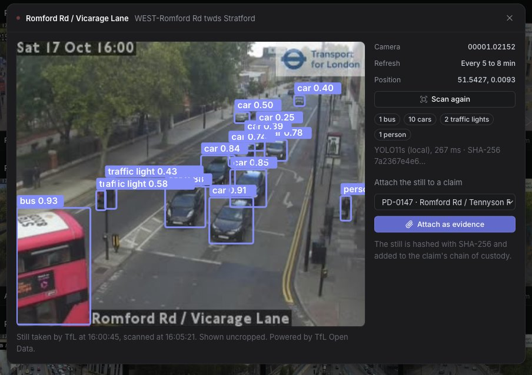
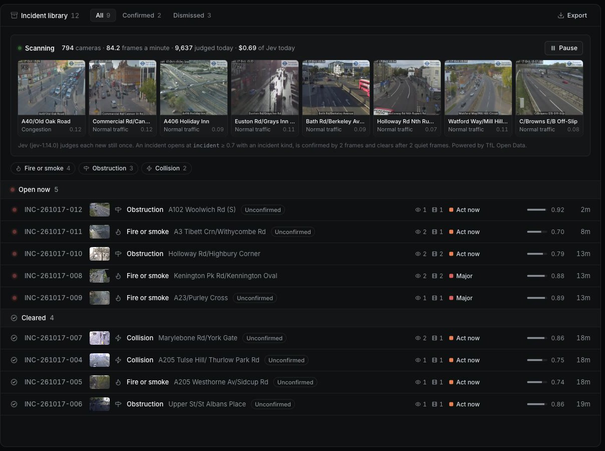
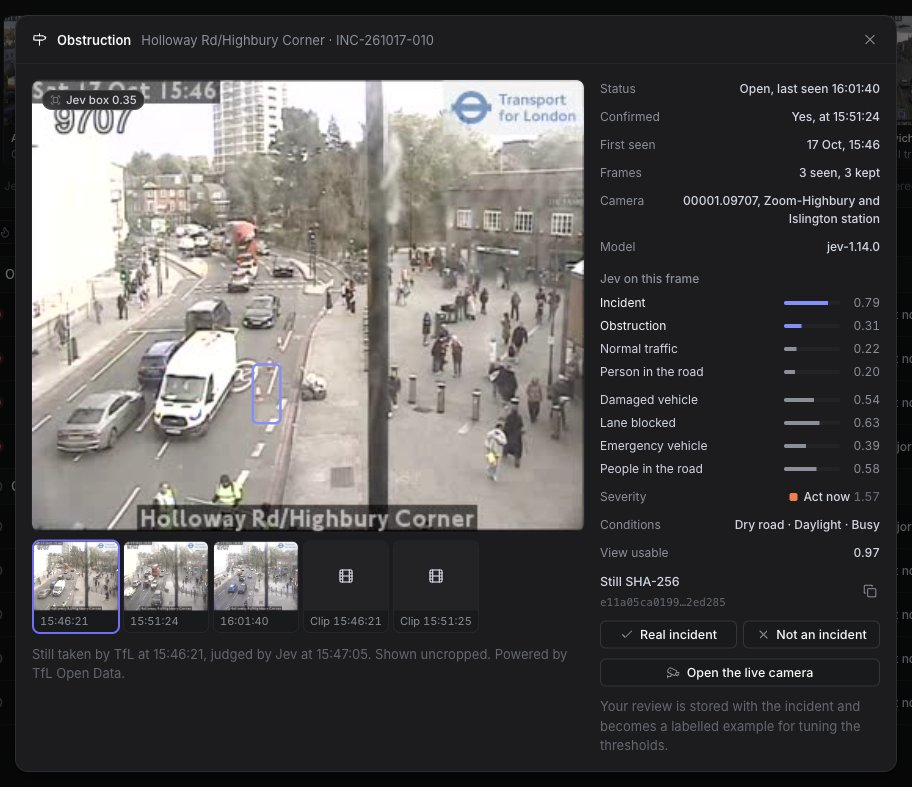
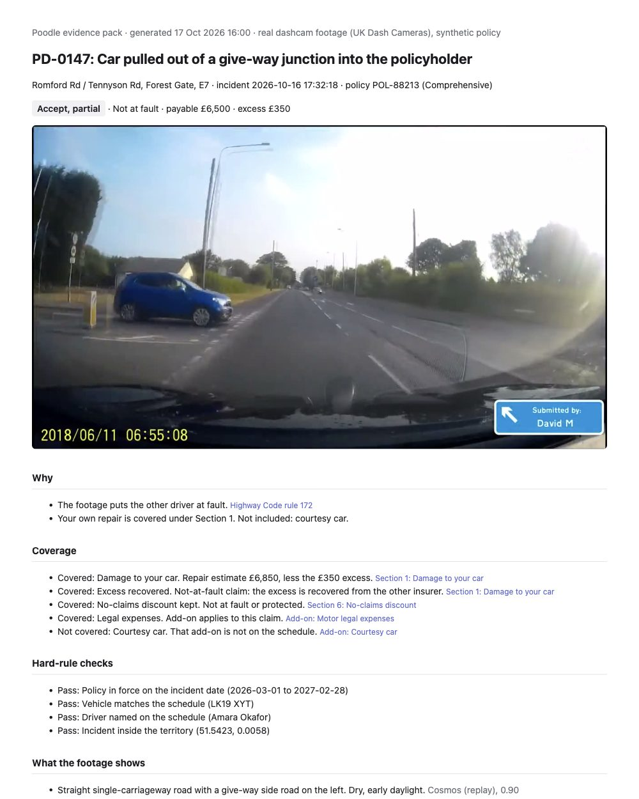

<p align="center">
  
</p>

<h1 align="center">Poodle</h1>

<p align="center">
  A claims desk for car accidents. Poodle watches the dashcam video, checks the driver's story<br>
  and works out what the policy pays. When it isn't sure, it hands the claim to a person.
</p>

<p align="center">
  Built in one day at the Real-Time Video Agents hackathon, VAST London, 17 October 2026.
</p>

<p align="center">
  <a href="#a-quick-tour">Tour</a> ·
  <a href="#how-poodle-decides">How it decides</a> ·
  <a href="#run-it">Run it</a> ·
  <a href="#demo-in-90-seconds">Demo</a> ·
  <a href="#the-incident-library-in-more-detail">Incident library</a>
</p>



## Why we built it

After a crash, an insurer has to answer a few questions. What happened? Who caused it? What does the policy cover? Today a claims handler works this out by hand, watching the video and checking the policy line by line.

Poodle does that first pass for them. It:

- spots the cars and traffic lights in the video, and writes down what happens moment by moment
- checks every sentence of the driver's statement against what the camera saw
- decides the cover with fixed rules, and shows the policy clause or Highway Code rule behind each reason
- puts the closest live London traffic cameras next to the evidence
- keeps a fingerprint (a SHA-256 hash) of every file, so you can tell if anything changes later

A person still makes the call on anything unclear. Poodle tells them why it's unclear. (The poodle on each claim page has moods, by the way. It's happy when a claim can be paid and alert when a person should look.)

## A quick tour

### The inbox



Claims that need a person come first. A row tells you what Poodle recommends, what the claim is worth and who owns it. Press `J` and `K` to move, and `Enter` to open one.

### A claim

The screenshot at the top of this page is a claim. The dashcam clip plays on the left. Click a finding under the video and the clip jumps to that moment, with boxes from YOLO (an object detector) on what it found. Below that, the recommendation shows what's covered, what isn't and how much gets paid now. The right side has the policy, a map, the rule checks and the evidence log.

### Checking the story



Poodle breaks the driver's statement into small claims. It marks each one as supported, contradicted, or unverifiable when the video can't show it. In this claim the van driver says he was already on the roundabout. The motorcyclist's helmet camera shows he wasn't.

You can also ask the footage a question. Answers point to the finding they came from, or say "Not visible" when the video can't tell. Speed is a good example. One dashcam can't measure it, so Poodle won't guess.

### Live cameras



Every claim gets the four Transport for London (TfL) traffic cameras closest to it, with distances. London has about 800 of these cameras, and they post a new picture every 5 to 8 minutes.



Open a camera and scan its latest picture with YOLO. If it helps, attach it to a claim. The picture gets a fingerprint and goes into the claim's evidence log.

### The incident library



While the server runs, Poodle watches every TfL camera in London. New pictures go to Jev, a fast decision model from TypeSafe. Jev answers a fixed set of questions about each one: is there an incident, what kind, how bad, is a lane blocked, and so on. Code turns those answers into incidents. An incident keeps its pictures, the camera's 10-second video and every answer Jev gave.



It makes mistakes. Low sun and dirty lenses can look like smoke to it. When that happens, click "Not an incident". Your reviews are saved with the incident, and we'll use them to tune it.

### The evidence pack



There's a one-page report for every claim, ready to print or send. It has the decision and the reasons, what's covered, the checks, the findings, the statement check and the fingerprint of every file.

### Keyboard shortcuts

| Keys | What they do |
| --- | --- |
| `⌘K` | Search, or jump to any claim, camera or page |
| `J` / `K` | Move down / up the list |
| `Enter` | Open the selected claim |
| `Esc` | Go back to the list |
| `Space` | Play or pause the footage |
| `D` | Show or hide the detection boxes |
| `⌘Enter` | Approve the recommendation |
| `G` then `I`, `C`, `A` or `L` | Go to the inbox, cameras, all claims or the incident library |
| `?` | Show every shortcut |

## How Poodle decides

We split the work so each part does what it's good at.

- Code handles anything with one right answer: dates, money, whether the driver is named on the policy, and the decision table itself.
- Jev answers questions with a fixed list of possible answers. For example, it picks who caused the crash from five options. Every answer comes with a confidence score.
- A language model only writes sentences, like the answers to your questions about the footage.

Sometimes Poodle doesn't decide. It sends the claim to a person when Jev is less than 50% sure about an important answer, when there isn't enough evidence, or when the fraud signs are strong. The claim page says which one it was.

## Run it

You need [uv](https://docs.astral.sh/uv/).

```bash
cp .env.example .env    # optional: put API keys here (this file is never committed)
uv run --with-requirements server/requirements.txt uvicorn server.app:app --port 8080
```

Then open http://localhost:8080.

Every key is optional. Without them, Poodle uses recorded answers, so the demo always works. Restart the server after you change `.env`.

To scan live cameras with YOLO on your own laptop, run the server in an environment that also has `ultralytics`:

```bash
uv venv .venv --python 3.12 && uv pip install --python .venv/bin/python -r server/requirements.txt ultralytics
.venv/bin/python -m uvicorn server.app:app --port 8080
```

## What's live and what's recorded

Each service switches on when its key is in `.env`. Without the key, Poodle falls back to recorded data and keeps working.

| Part | Live with | Without it |
| --- | --- | --- |
| London traffic cameras | No key needed (`TFL_APP_KEY` raises TfL's rate limit) | The last saved camera list |
| YOLO scan of a live camera | `YOLO_URL`, or `ultralytics` installed locally | The scan says no detector is connected |
| Boxes on the claim footage | Worked out ahead of time with YOLO11s (`server/tools/detect_stills.py`) | Same |
| Coverage decision | `TYPESAFE_API_KEY` or `OPENROUTER_API_KEY` (Jev) | Recorded Jev answers |
| Questions about the footage | `COSMOS3_REASON_URL` (Cosmos Reason) or `WANDB_API_KEY` (W&B Inference) | Answers built from the findings |
| Incident library | A Jev key | Off |
| Event store | `VASTDB_ENDPOINT`, `VASTDB_ACCESS_KEY` and `VASTDB_SECRET_KEY` | `server/data/events.jsonl` |

`.env.example` lists every setting, with a note on where to get each key.

## The incident library, in more detail

The scanner is in `server/watch.py`. Here's what it does.

1. About once a minute it asks each camera whether its picture has changed. A picture that hasn't changed costs nothing.
2. A new picture goes to Jev once, with 12 questions in a single request. Is there an incident? What kind? Is a lane blocked? Is the road wet? There are eight more like these, plus a box around the problem.
3. One picture that scores 0.7 or more, with an incident type such as a collision or a breakdown, opens an incident. A second picture confirms it.
4. Two quiet pictures in a row close it. So do 30 minutes with no new picture.

Every judged picture also goes into a daily log. That gives you road conditions and traffic for every camera in London, every few minutes. It all lives in `server/data/library/`, which isn't committed and is served at `/library/`.

| File | What's in it |
| --- | --- |
| `observations-<date>.jsonl` | One line per picture: camera, time, every answer, tokens used |
| `incidents.json` | The incident library (the Export button downloads it) |
| `frames/` and `clips/` | Incident pictures and 10-second clips, each with a SHA-256 hash |

Opened, confirmed, cleared and reviewed incidents also go to `events.jsonl`, and to VastDB once it's set up.

### What it costs

A picture costs about 1,700 Jev tokens, roughly $0.00007. All of London comes to about 7,000 pictures and $0.50 an hour.

### How to control it

Use the Pause button on the page. It stays paused after a restart. Or use these settings in `.env`:

| Setting | What it does |
| --- | --- |
| `POODLE_WATCH=off` | Turns the scanner off |
| `POODLE_WATCH_LIMIT` | Scans only the N cameras nearest central London |
| `POODLE_WATCH_DAILY_USD` | Stops for the day once Jev spend reaches this many dollars |
| `POODLE_WATCH_CONCURRENCY` | How many Jev requests run at once (6 by default) |
| `POODLE_LIBRARY_DIR` | Keeps the library somewhere else, like a bigger disk |

### Why the threshold is 0.7

In a test, real crash pictures scored between 0.94 and 0.99. The highest normal London picture in the first sweep scored 0.63, and that was a smudged lens. So 0.7 sits in the gap. Some sun glare still gets through, which is why the review buttons are there. The questions and thresholds are all at the top of `server/watch.py`.

## Demo in 90 seconds

1. The inbox has seven claims that need a person. Open PD-0147 (`J`/`K`, then `Enter`).
2. The policyholder's dashcam plays. A blue Vauxhall Mokka pulls out of a give-way junction into her. Click the finding "Blue car broadside across the policyholder's lane" and the clip stops there, with a YOLO box on the car. The two nearest live TfL cameras sit beside it.
3. Ask "Where was the point of impact?" (the answer cites the impact finding). Then ask "How fast was the other car going?" (the answer is "Not visible").
4. The recommendation is accept, partial. The other driver is at fault under Highway Code rule 172, and the courtesy car isn't on her policy. Poodle pays £6,500 now and recovers £6,850 from the other insurer.
5. Open a live camera, scan its latest picture and attach it to the claim. It joins the evidence log with its fingerprint.
6. Press `⌘K` and type "camden". PD-0226 (hit from behind in traffic) can be paid without a handler. PD-0188 (a car cut in from a slip road, then braked hard) has a fraud flag and goes to the special investigations team. In PD-0204 the van driver says he was already on the roundabout, and the rider's helmet camera says he wasn't.
7. Press `G` then `L` for the incident library: the scanner's live feed and the incidents it found today.
8. Open the evidence pack: one printable page with the decision, the findings, the statement check and the file fingerprints.

The amounts in steps 4 and 6 come from the recorded Jev answers. See the next section.

## What doesn't work yet

- Live Jev is stricter than the recorded answers. With a Jev key set, it sends most claims to a person for now.
- The incident scanner has false alarms, mostly sun glare and dirty lenses.
- The Cosmos Reason, W&B Inference and VastDB connections are written but not tested. We didn't have those credentials on the laptop we built this on.

## Where the footage comes from

The claim videos are real UK dashcam and helmet-camera clips sent in to UK Dash Cameras. The originals are in `poodle/media/raw/` (about 90 MB). `server/tools/build_media.py` cuts them into 720p web clips with posters (about 16 MB). The findings, statement checks and Jev answers were written for each clip. The places, dates, people and policies are made up, so the dates burned into the videos don't match the claims.

Live camera pictures come from TfL JamCams. Powered by TfL Open Data.

We also tried generating crash clips. `server/tools/luma_videos.py` makes 5-second CCTV-style clips with Luma Ray2 on Amazon Bedrock, with the camera locked in place. The desk doesn't use them. It plays the real footage. Ray2 only runs in us-west-2, costs $7.50 per clip and needs `aws sso login`.

## Deploying

The code is small, but the video isn't. To keep the media out of a small deploy, upload `poodle/media/` to a bucket and set `POODLE_MEDIA_BASE` to its URL.

## Project layout

```text
server/               FastAPI backend (port 8080)
  app.py              API routes, and serves the web app
  engine.py           hard rules, the decision table, offline answers
  services.py         YOLO, Cosmos Reason, W&B Inference, Jev and VastDB
  tfl.py              the TfL camera list
  watch.py            the background scanner and incident library
  tools/              build the clips, precompute YOLO boxes, Luma clips
  data/               claims, policies and detections (runtime files are not committed)
poodle/               the web app: plain JavaScript modules, no build step
docs/                 the idea, the hack plan, the UI audit and these screenshots
agent-coordination/   the shared taskboard for coding agents
```

Built with FastAPI, TfL JamCams, YOLO11 from Ultralytics, TypeSafe Jev, NVIDIA Cosmos Reason, W&B Inference and VastDB.

More reading: [the idea and agent design](docs/IDEA.md), [the hack plan](docs/hack-plan.md) and [the UI audit](docs/ui-audit.md).

## Working on this repo with coding agents

This repo was set up with `hackathon-init`. Claude Code, Cursor, Codex and any agent that reads [`AGENTS.md`](AGENTS.md) share one taskboard: [`agent-coordination/taskboard.md`](agent-coordination/taskboard.md). Each agent writes down what it's building, saves progress as it goes, and can pick up a task another agent left half done.

Every turn starts by pulling from GitHub, in case someone else pushed. Every commit is pushed straight away. After you clone, turn that on once:

```bash
./scripts/agent-taskboard.sh setup
```
