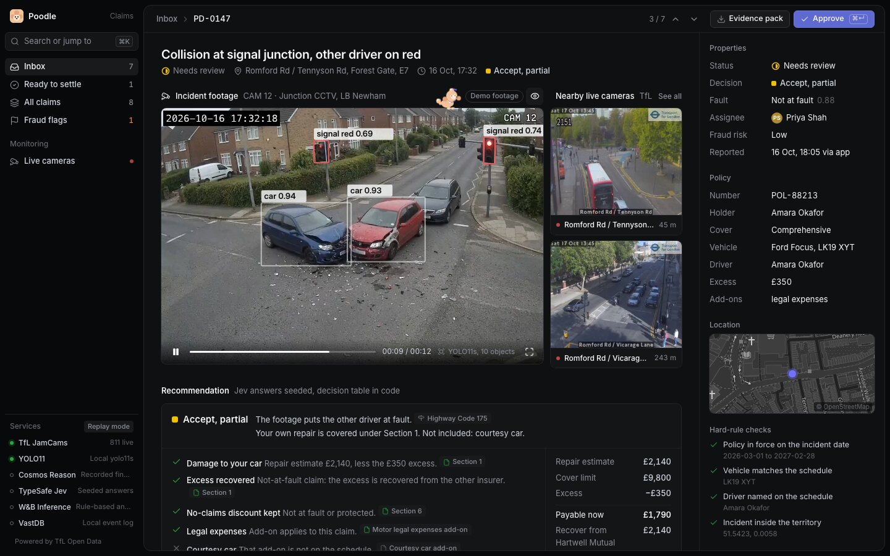

# REAL-TIME VIDEO AGENTS HACKATHON

# vast-real-time

Hackathon project, bootstrapped with `hackathon-init`.

## Poodle

A claims desk for road incidents. Poodle watches the incident footage, spots the vehicles and signals, checks the statement against what the camera saw, decides cover against the policy, and puts the nearest live London traffic cameras next to the evidence. Idea and agent design: [`docs/IDEA.md`](docs/IDEA.md). UI audit and redesign notes: [`docs/ui-audit.md`](docs/ui-audit.md).



### Run it

```bash
cp .env.example .env   # optional: paste API keys into .env (gitignored), never into .env.example
uv run --with-requirements server/requirements.txt uvicorn server.app:app --port 8080
# open http://localhost:8080
```

Every key is optional; each one switches a service from replay to live (see the comments in `.env.example`). Restart the server after editing `.env`.

To scan live TfL stills with YOLO on a laptop, run the server in an environment that also has `ultralytics` (the local fallback detector):

```bash
uv venv .venv --python 3.12 && uv pip install --python .venv/bin/python -r server/requirements.txt ultralytics
.venv/bin/python -m uvicorn server.app:app --port 8080
```

### What is real and what is replayed

| Part | Source |
| --- | --- |
| Live London cameras | TfL JamCams API, live (stills refresh every 5–8 min, 10 s clips). Powered by TfL Open Data. |
| Incident library | Background scan of every live JamCam; Jev judges each new still and code keeps the incidents (`server/watch.py`). Needs a Jev key. |
| Detection boxes on incident footage | YOLO11s, precomputed on the demo stills (`server/tools/detect_stills.py`). Signal colour from a pixel check on each traffic-light box. |
| Live camera scan | YOLO11s on the latest TfL still: `$YOLO_URL` on the event stack, else local `ultralytics`. |
| Coverage decision | Hard rules and the decision table run in code (`server/engine.py`). Typed answers come from Jev when `TYPESAFE_API_KEY` or `OPENROUTER_API_KEY` is set, otherwise from seeded answers. |
| Footage Q&A | W&B Inference when `WANDB_API_KEY` is set, otherwise rule-based answers over the findings. |
| Evidence | SHA-256 of every file, custody log, printable evidence pack (`/api/claims/<id>/pack`). |
| Events | `server/data/events.jsonl`, and VastDB when `VASTDB_ENDPOINT`, `VASTDB_ACCESS_KEY` and `VASTDB_SECRET_KEY` are set. |

Incident footage is demo footage: the team's synthetic CCTV stills (`Demo img/`) turned into 12 s clips by `server/tools/build_media.py`, with the burned-in clock set to each claim's incident time. Policies are synthetic.

Generated accident clips: `server/tools/luma_videos.py` makes 5 s CCTV clips of the crash itself with Luma Ray2 on Amazon Bedrock. Both ends are pinned to the camera's framing so it cannot move: the first keyframe is the still with the crashed cars erased (Stability Erase Object, masked from the YOLO boxes), the last is the evidence still, and the prompt says who broke which rule. Clips land in `poodle/media/luma/` with a manifest of prompts and job ARNs. Ray2 runs only in us-west-2 (async, one job at a time, $7.50 per 5 s 720p clip) and needs `aws sso login`. The desk still plays the 12 s clips.

Code is about 200 KB. Media is about 3 MB; to keep it out of a 1 MiB deploy, upload `poodle/media/` to a bucket and set `POODLE_MEDIA_BASE` to its URL.

### Incident library: every London camera, judged around the clock

Whenever the server runs with a Jev key, `server/watch.py` scans every live TfL JamCam in the background. It polls each still with a conditional GET, so an unchanged frame costs one empty 304; TfL publishes a new still every 5–8 minutes per camera. Each new still goes to Jev once, with 12 typed questions in one request: is there an incident, what kind, how severe, damaged vehicle, lane blocked, emergency vehicle, people in the road, traffic, road surface, light, and a box around the scene. Code turns the answers into incidents. One frame at `incident` ≥ 0.7 with an incident kind opens one, a second frame confirms it, and two quiet frames (or 30 minutes without a frame) clear it. Each incident keeps its stills, the camera's 10 s clip, both with SHA-256, and Jev's answers for every frame.

In the desk: Monitoring, then Incident library (`G` `L`). It shows the scanner's state and spend, the latest frames Jev judged, filters by kind, and a dialog per incident with the stills, Jev's box, the clip and "Real incident" / "Not an incident" buttons. Reviews are saved with the incident as labels for tuning the thresholds.

The data mine lives in `server/data/library/` (gitignored, served at `/library/`):

- `observations-<date>.jsonl`: one row per judged frame (camera, time, every typed answer, tokens), so road surface, light and traffic for every camera every few minutes.
- `incidents.json`: the library itself (the Export button).
- `frames/` and `clips/`: incident stills and clips.

Incident events (opened, confirmed, cleared, reviewed) also go to `events.jsonl`, and to VastDB when it is configured.

Cost: about 1,700 input tokens per frame ($0.00007), so all ~810 cameras come to about 7,000 frames and $0.50 of Jev an hour. Controls: the Pause button (remembered across restarts), `POODLE_WATCH=off`, `POODLE_WATCH_LIMIT` (only the N cameras nearest central London), `POODLE_WATCH_DAILY_USD` (stop for the day at a budget), `POODLE_WATCH_CONCURRENCY` (parallel Jev requests, default 6) and `POODLE_LIBRARY_DIR` (keep the library on another disk). On shutdown the scanner saves each camera's last judged still, so a restart only judges stills that changed.

Calibration so far: crash stills scored `incident` 0.94–0.99, while a first sweep of 1,656 live London frames peaked at 0.63 (lens smears, sun flare). The 0.7 threshold sits between the two. Questions and thresholds are together at the top of `server/watch.py`; retune them with the review labels.

### Demo in 90 seconds

1. Inbox: seven claims need a person. Open PD-0147 (J/K, Enter).
2. The footage plays with YOLO boxes; both main-road signals read red. The two nearest live TfL cameras sit beside it, 45 m and 243 m away.
3. Ask "What colour was the light?" (cites the signal finding), then "How fast was the other car going?" ("Not visible").
4. Recommendation: accept, partial. The other driver is at fault (Highway Code 175); the courtesy car is not on the policy. £1,790 payable, £2,140 recovered.
5. Open a live camera, scan the latest still, attach it as evidence: it joins the chain of custody with its hash.
6. Cmd+K, type "camden": PD-0226 settles without a handler. PD-0188 shows the fraud flag and goes to the SIU.
7. Evidence pack: one printable page with the decision, findings, statement check and hashes.

## Working on this repo with coding agents

Claude Code, Cursor, Codex and any agent that reads [`AGENTS.md`](AGENTS.md)
share one taskboard: [`agent-coordination/taskboard.md`](agent-coordination/taskboard.md).
Each agent registers what it is building, checkpoints as it goes, and can take
over a task another agent left unfinished.

Every turn starts by pulling from GitHub, in case someone else pushed.
Every commit is still pushed automatically. After cloning, enable that once:

```bash
./scripts/agent-taskboard.sh setup
```
