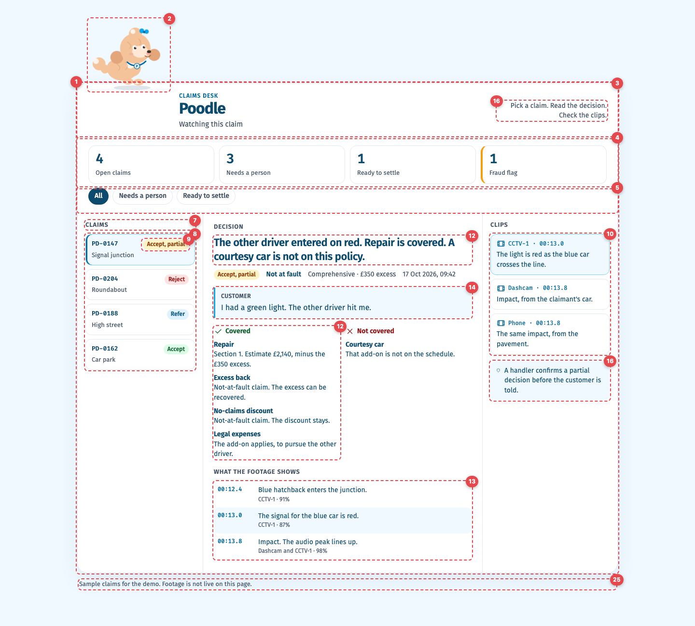
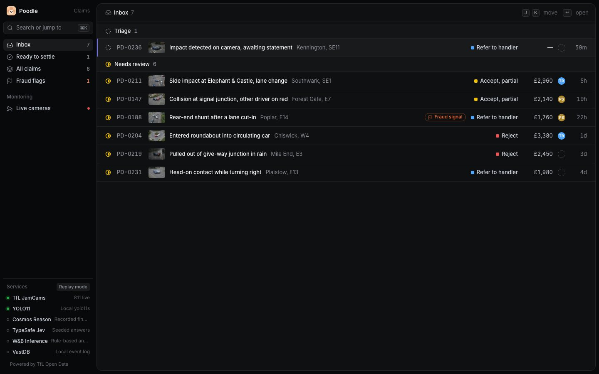
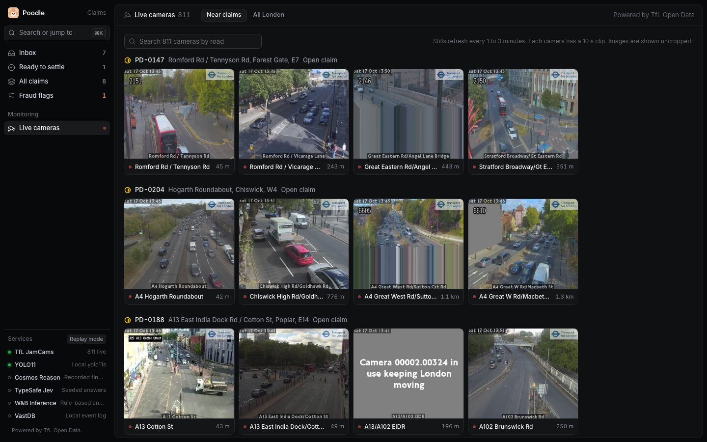
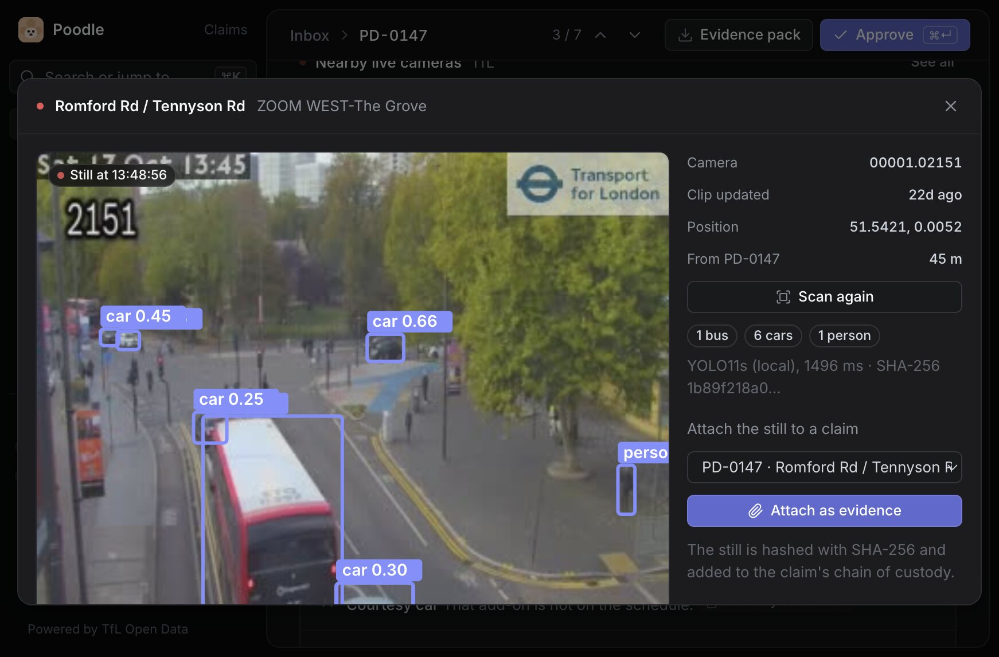
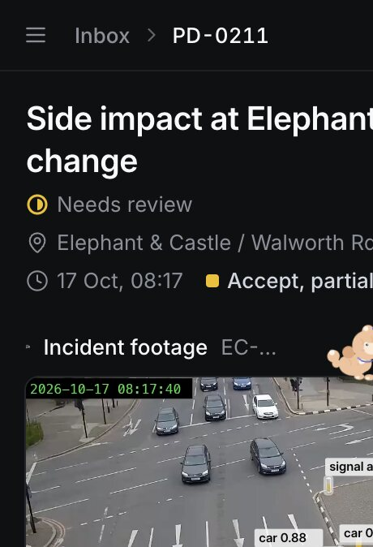

# Poodle desk: UI audit

Audited 17 Oct 2026, 13:35 BST, against `poodle/index.html` at commit `52ab79b` (the light "executive desk"). Line numbers refer to that commit: `git show 52ab79b:poodle/index.html`. The redesign landed the same afternoon; the Status column says what changed.

The brief for the redesign:

- Make the desk look like a professional tool, following Linear's design system.
- Show the incident footage, together with live London traffic cameras.
- Keep the animated poodle mascot from the earlier brief.

## Before

Unmarked findings (6, 11, 15 and 17–24) apply to the whole page rather than one element.

## After

The claim view: incident footage with YOLO11s boxes, the two nearest live TfL JamCams, the recommendation, and Linear's properties panel.

| Inbox | Live cameras |
| --- | --- |
|  |  |

| Live TfL still scanned by YOLO11s | Phone, 390 px |
| --- | --- |
|  |  |

## What Linear does that this desk should copy

Taken from Linear's own CSS (linear.app, fetched today) and its write-up [How we redesigned the Linear UI](https://linear.app/now/how-we-redesigned-the-linear-ui):

- **Theme**: dark by default. Surfaces step up in small increments (`#08090a`, `#0f1011`, `#141516`, `#191a1b`), separated by hairline borders (`#23252a`) rather than shadows. Text has four levels (`#f7f8f8`, `#d0d6e0`, `#8a8f98`, `#62666d`).
- **Colour restraint**: colour only for status and the accent (`#5e6ad2` brand, `#7170ff` interactive). Status hues are green `#27a644`, yellow `#f0bf00`, red `#eb5757`, orange `#fc7840`, blue `#4ea7fc`.
- **Type**: Inter Variable with `cv01` and `ss03`, weights 400/510/590/680. Body text is 13 px, small labels 12 px, titles 15–24 px. Hierarchy comes from brightness and weight more than size.
- **Layout**: a 232 px sidebar holds the workspace and navigation. Content sits in an inset panel with a slim view header (view name, view tabs, display options) and dense list rows. A properties panel sits on the right of a detail view.
- **Interaction**: keyboard first (Cmd+K command menu, J/K to move, Enter to open, Esc to go back), instant hover states, no decorative motion.

## Findings

| # | Where (old lines) | What was wrong | Change | Status |
| --- | --- | --- | --- | --- |
| 1 | `.page`, `.desk` (58–70, 377–379) | The app is a 1120 px card floating on a pale page, with 136–172 px of top padding. At 1440 px a third of the screen is empty margin. | Full-height app shell: sidebar on the left, inset content panel filling the rest. | Done |
| 2 | `.perch`, poodle SVG (72–147, 411–466) | The 168 × 150 px mascot is the first and largest thing on screen, above the evidence. | The poodle keeps its three moods but is now 48 px, perched on the top edge of the incident player. The workspace mark in the sidebar is a small poodle face. | Done |
| 3 | `.desk-head` (149–183, 468–475) | A "CLAIMS DESK" eyebrow, a 32 px product name, the mood line and an instruction sentence use 92 px to say "this is Poodle". | Brand moved to the sidebar. Each view has a 44 px header with breadcrumb, pager and actions. | Done |
| 4 | `.kpis` (185–206, 477–482) | Four large KPI cards repeat the same counts as the filter chips below them. This is the generic SaaS card pattern. | Counts sit in sidebar badges and list group headers, as in Linear. | Done |
| 5 | `.filters` chips (208–236, 484–488) | Pill chips with a heavy navy pressed state sit apart from the list they filter. | The filters became sidebar views (Inbox, Ready to settle, All claims, Fraud flags). The list groups by status inside each view. View tabs are used on Live cameras. | Done |
| 6 | `:root` palette (15–32) | Light sky-blue theme with navy text. It reads as a marketing page, not a tool, and it does not follow the brief. | Linear dark tokens. Colour is used only for decision status, the fraud flag and live indicators. | Done |
| 7 | Fira Sans/Code and uppercase labels (10, 158–172, 240–247) | Two families, tracked uppercase section labels ("CLAIMS", "DECISION", "CLIPS") and monospace ids. | Inter throughout with `cv01`/`ss03`, sentence-case headers, tabular figures for ids, money and times. Monospace only for file hashes. | Done |
| 8 | `.rows` / `.row` (248–268, 674–699) | Claims are rounded bordered cards with 8 px gaps: only four fit, and they show no status icon, time, value or fraud marker. | 44 px rows with hairline separators: status glyph, id, thumbnail, title, area, fraud chip, decision, estimate, assignee, age. J/K moves the selection, Enter opens. | Done |
| 9 | `.pill` (271–282) | Pastel filled pills ("Accept, partial" in amber on cream) are the loudest element on each row. | An 8 px square in the status hue, plus the label in neutral text. | Done |
| 10 | `.proof` clips (344–360, 500–502, 750–769) | "Clips" are text descriptions. No footage or frame is shown anywhere, in a product that is a video agent. | Incident player first: a 12 s clip with play, seek and full screen, YOLO11s boxes drawn over it, and a detections toggle. Hovering or clicking a finding highlights its boxes. The demo clips are static aftermath shots, so findings highlight boxes instead of seeking to a time. | Done |
| 11 | Whole page | No location and no live context. The adjuster cannot check the junction, its signals or current traffic. | Each claim shows the two nearest live TfL JamCams (45 m away for PD-0147). The Live cameras view lists the nearest cameras for every claim, searches all of London, plays each 10 s clip, scans the latest still with YOLO11s and attaches it to a claim as hashed evidence. A dark OpenStreetMap tile shows the location. | Done |
| 12 | `.sentence`, `.meta`, `.split` (284–324, 701–748) | The decision is a block of prose, then a meta line, then two bullet lists. Money is buried in sentences ("Estimate £2,140, minus the £350 excess"). | Recommendation card: outcome, reasons with citation chips (policy clause or Highway Code rule, click to read), a covered and not-covered checklist, and the settlement maths in a table. Properties panel on the right. | Done |
| 13 | `.timeline` (326–342) | Event confidence is plain text ("91%"). Events are not linked to the footage. | Each finding has a confidence bar. Below the 0.5 floor it turns orange. Each finding links to its boxes on the footage. | Done |
| 14 | `.said` (301–309) | The customer's statement is quoted, but nothing says whether the footage supports it, although the statement check is a headline feature in `docs/IDEA.md`. | Statement check: each claim in the statement is marked supported, contradicted or unverifiable, with "Show in footage" for the deciding finding. | Done |
| 15 | Whole page | There is no way to ask the footage a question, the main video-agent interaction. | "Ask the footage" with suggested questions. Answers cite the finding they rest on and say "Not visible" when the footage cannot answer (for example, speed). Rule-based in replay mode; W&B Inference when `WANDB_API_KEY` is set. | Done |
| 16 | `.how`, `.signoff` (178–183, 361–371) | The page tells the user what to do ("Pick a claim. Read the decision.") but offers no action. Sign-off is a passive note. | Header actions: Approve (or Take the case for referrals), Refer to SIU on fraud flags, Evidence pack, Reopen. Cmd+Enter approves. | Done |
| 17 | Script state (637) | No routing. A reload loses the open claim and a claim cannot be linked. | Hash routes: `#/inbox`, `#/claim/PD-0147`, `#/cameras?near=PD-0147`, `#/cameras?q=euston`. | Done |
| 18 | Whole page | No keyboard shortcuts and no command menu. | Cmd+K searches views, claims and live cameras. J/K, Enter, Esc, Space (play), D (detections), G then I/C/A/R/F, and `?` for the list. | Done |
| 19 | `const claims` (509–635) | Claims are hard-coded in the page. | Served by the backend (`/api/claims`). The decision is computed server-side by the code decision table. | Done |
| 20 | Whole page | Chain of custody is the legal pitch, but no file hash or custody record is visible. | Chain of custody in the properties panel: each file with its SHA-256 (copyable). Attached TfL stills join the list. The evidence pack prints all of it. | Done |
| 21 | Whole page | Nothing says which agents or models ran, or whether the data is live. | Services in the sidebar footer: TfL and YOLO11s live; Cosmos, Jev, W&B Inference and VastDB show "Replay mode" until their keys are set. | Done |
| 22 | Radii and shadow (31, 69, 194, 219, 252) | Radii of 20, 14, 12 and 999 px, plus a soft 40 px drop shadow under the desk. | Linear's scale (4/6/8/12 px), hairline borders, shadow only on dialogs and the command menu. | Done |
| 23 | Mobile (402–405) | At 390 px the three columns stack into one long scroll, with the mascot and KPIs before any claim. (No horizontal overflow, measured at 390 px.) | Sidebar becomes a drawer. The list drops secondary columns. The claim opens on the footage, with live cameras two-up below it. Measured again at 390 px: no horizontal overflow. | Done |
| 24 | Accessibility (46–56, 145–147, 233–236) | Good: skip link, `aria-pressed`, visible focus, reduced-motion support, mood written in text. | Kept all of it. Icon-only buttons have labels, the mood is announced in a status region, dialogs trap Esc and restore focus. The clips have no audio, so the player has no captions. | Done |
| 25 | `.note` (505) | "Footage is not live on this page" is the only honesty marker, in small grey text below the desk. | "Demo footage" chip on every incident player, live dots and "Powered by TfL Open Data" on TfL media, a "Replay mode" chip for services that are not connected. | Done |

## Still open

- The sponsor-stack calls (YOLO on the event stack, Cosmos, W&B Inference, Jev, VastDB) are written but not tested: there are no credentials on the build laptop. Each one falls back to replay and says so.
- Demo footage is the team's synthetic stills turned into 12 s static clips, with the 2024 clock replaced by the claim's incident time. Real multi-camera footage would let findings seek to a moment.
- Map tiles come from the public OpenStreetMap server, which is fine for a demo but not for production traffic.
